# ZMK Keyboards Configuration

Automatically generated keymap diagrams via [`keymap-drawer`](https://github.com/caksoylar/keymap-drawer).

## Planck

## AUM

## Polaris

## Corne V4

## Corne

## Charybdis

## Sofle-E

## Sofle-Plus

## Sofle-X

